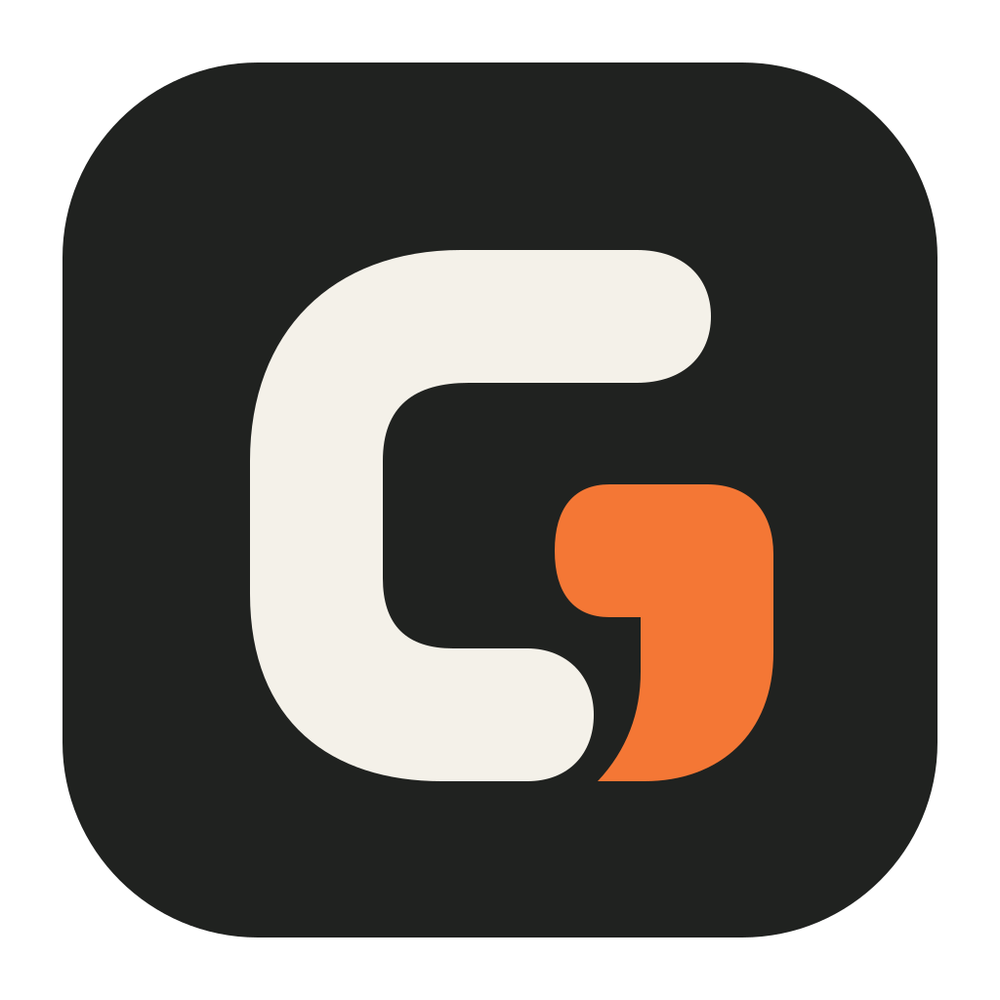

<p align="center">
  
</p>

# Goko

Goko is a desktop app for macOS, Linux and Windows for running interactive
command-line agents by project. The native Rune app (`apps/rune`) talks to the
Rust `gokod` daemon, which owns the terminal processes — over a Unix socket on
macOS and Linux, and a named pipe on Windows. Project and session metadata is
stored separately in SQLite. See [ARCHITECTURE.md](ARCHITECTURE.md) for how the
pieces fit together.

## Layout

| Path | What it is |
|---|---|
| `apps/rune` | The native app (Cargo package `goko-rune`): UI, terminal, editor |
| `crates/rune-kit` | Generic, themable Rune UI component kit used by `apps/rune` |
| `crates/daemon` | `gokod`, the daemon that owns every PTY and child process |
| `crates/protocol` | Wire messages and framing shared by the app and `gokod` |
| `crates/app-core` | `goko.db` store, Git/worktrees, agents, ACP, language servers |

## Install (macOS Apple Silicon, Linux x86_64 and aarch64, Windows x86_64)

```sh
curl -fsSL https://github.com/asta-nguyen/goko/releases/latest/download/install.sh | sh
```

On Windows (10 1809 or later):

```powershell
irm https://github.com/asta-nguyen/goko/releases/latest/download/install.ps1 | iex
```

This downloads the latest release, checks its sha256 (and, on macOS, its
signature), and installs it; run it again to update. On macOS it installs
`Goko.app` in `~/Applications`. The app is signed ad hoc (free, no Apple
Developer account), so install it with this command: a copy downloaded through
a browser is quarantined and macOS asks you to allow it in System Settings →
Privacy & Security.

On Linux it puts `goko` in `~/.local/bin` (the app and `gokod` in
`~/.local/share/goko`) and adds a launcher entry. It needs a desktop session, a
working Vulkan or OpenGL driver and `libxkbcommon`. The release workflow builds
the Linux archives; the installed app has not been run on a desktop.

On Windows the installer puts the app and `gokod` in `%LOCALAPPDATA%\Goko\app`,
adds `goko` to your user PATH and a Start-menu shortcut, and re-running it
updates in place. The archive is unsigned, so SmartScreen warns the first time;
choose **More info → Run anyway**. Windows 10 1809 or later is required (ConPTY).
Stopping a session on Windows kills its whole process tree at once — there is no
graceful signal — and the trash, sound, in-app updater, quit veto, and
`ps`-based agent attribution are not available there yet.

Intel Macs build from source (below).

Goko → Settings → Updates shows the running version and tells you when a newer
release is out and what changed in it (set `GOKO_NO_UPDATE_CHECK=1` to stop the
automatic check). **Update now** installs it over the copy that is running (also
in `/Applications`); reopen Goko afterwards. A copy it cannot replace (built from
source, or in a folder you cannot write to) offers the install command to run
instead.

## Prerequisites

- Rust stable, installed with [rustup](https://rustup.rs/).
- macOS: Xcode Command Line Tools (`xcode-select --install`).
- Linux: a C toolchain, `git`, `pkg-config`, and the font, X11/Wayland and GPU
  libraries that `winit`/`wgpu` need. On Debian or Ubuntu:
  `sudo apt-get install build-essential pkg-config libfontconfig1-dev libwayland-dev
  libxkbcommon-dev libx11-dev libxcb1-dev libxkbcommon-x11-dev libvulkan-dev`.
- Windows: Rust stable with the MSVC toolchain (the default `stable-x86_64-pc-windows-msvc`
  target and the Visual Studio Build Tools that rustup asks for), plus `git`.
  Windows 10 1809 or later (ConPTY).

The terminal engine is built with Zig 0.16 and bindgen (libclang); see Build below.
No Node or pnpm is needed.

## Build

`crates/vt` builds libghostty-vt with Zig 0.16 from the `vendor/ghostty`
submodule — fetch it with `git submodule update --init --depth 1` — and
generates bindings with bindgen, which needs libclang. On macOS:
`brew install zig@0.16`, then `export ZIG=$(brew --prefix zig@0.16)/bin/zig`.
On Linux: `sudo apt-get install clang libclang-dev` and Zig 0.16 from
ziglang.org. On Windows: Zig 0.16 and LLVM, with `LIBCLANG_PATH` pointing at
LLVM's `bin`. Zig fetches its package dependencies over the network on the
first build.

```sh
cargo build --workspace            # debug
cargo build --workspace --release  # release
```

Binaries land in `target/{debug,release}/`: `goko-rune` (the app) and `gokod`
(the daemon).

The macOS bundle and Linux release archive include the Goko app icon. Its vector
source is [icon.svg](apps/rune/assets/icon.svg); see the
[asset notes](apps/rune/assets/README.md) to regenerate the PNG and macOS icon.

## Run locally

The app starts `gokod` itself when no daemon answers on the socket, so you never
start the daemon by hand (to run it alone: `cargo run -p daemon`; `gokod --version`
prints its version, and a second instance prints `gokod: already running` and
exits). It looks for `gokod` beside its own executable (override
with `GOKO_DAEMON_BIN`), so build the whole workspace first.

### macOS

A bare binary opens no window on macOS, so `cargo run -p goko-rune` is not enough.
Use the bundle script: it builds the workspace, assembles `target/Goko.app` with
`gokod` beside it, kills any running instance, and launches the new build.

```sh
apps/rune/run-macos.sh          # release build (default)
apps/rune/run-macos.sh debug    # faster build, slower app
```

### Linux

```sh
cargo build --workspace --release
target/release/goko-rune
```

### Windows

```powershell
cargo build --workspace --release
target\release\goko-rune.exe
```

The app finds `gokod.exe` beside itself and starts it detached, so a fresh
`cargo build` is enough; there is no bundle step. To try a release build without
touching your install, use a throwaway home:
`$env:GOKO_HOME = "$env:TEMP\goko-dev"; target\release\goko-rune.exe`.

Known Windows limits in this version: stopping a session kills its whole process
tree at once (there is no graceful signal), session replies carry no signal name,
and the trash, sound, in-app updater, quit veto and `ps`-based agent attribution
are unavailable. Agent accounts share the default environment (no `/usr/bin/env`),
and Claude's statusline/usage capture and activity hooks do not run.

### Data and logs

App data lives in `$GOKO_HOME`. The default is `~/Library/Application Support/Goko` on
macOS, `$XDG_STATE_HOME/goko` (`~/.local/state/goko`) on Linux, and
`%LOCALAPPDATA%\Goko` on Windows. A Linux install that already has
`~/Library/Application Support/Goko` from an earlier version keeps using it. The folder
holds `goko.db`, `daemon.token`, `daemon.lock` and `daemon.log`, plus `daemon.sock` on
macOS and Linux (Windows serves a named pipe derived from the folder instead).

Keep development data separate from your normal data with a throwaway home:

```sh
GOKO_HOME=/tmp/goko-dev apps/rune/run-macos.sh   # Linux: GOKO_HOME=/tmp/goko-dev target/release/goko-rune
```

A fresh home gets its own daemon, so it never touches sessions in your real one.
To reset everything, quit Goko and delete that directory.

## Checks

```sh
cargo test --workspace                     # protocol, daemon and app tests
cargo fmt --check
cargo clippy --workspace --all-targets -- -D warnings
```

The daemon integration tests start the real `gokod` in a temporary `GOKO_HOME`.
CI runs the same checks on `ubuntu-22.04` and `macos-15`; on `windows-latest` it
builds the whole workspace and runs the `protocol`, `daemon` and `app-core`
tests (the app's own test harness is Unix-only in this version, and the Windows
daemon tests live in `crates/daemon/tests/windows_ipc.rs`).

## Releasing

A release is a pushed tag. The app's version is the workspace `version` in
`Cargo.toml` (it is what Settings → Updates compares), so the tag must equal it:

1. Set `version` in `[workspace.package]` of `Cargo.toml` (for example `0.2.0`),
   and rename the `Unreleased` heading in `CHANGELOG.md` to that version and the
   date, leaving a fresh `Unreleased` above it.
2. Merge to `main`, then `git tag v0.2.0 && git push origin v0.2.0`.

`.github/workflows/release.yml` then builds macOS (Apple Silicon), Linux (x86_64
and aarch64) and Windows (x86_64) and publishes the archives, a `latest.json`
manifest, `install.sh` and `install.ps1` as a GitHub release; the workflow
refuses a tag that does not match `Cargo.toml`. To try the builds without
publishing, run the workflow by hand (Actions → release → Run workflow): it
keeps the archives as artifacts.

macOS builds are signed ad hoc (no Apple Developer account, so no
notarization), which is why the installer is a `curl` command; see the macOS
note above. Windows builds are unsigned, so SmartScreen warns on first run. The
packaging scripts are `apps/rune/package-macos.sh`,
`apps/rune/package-linux.sh` and `apps/rune/package-windows.ps1`; the
installers are `distribution/install.sh` and `distribution/install.ps1`. `gokod`
has its own version (`gokod --version`).
