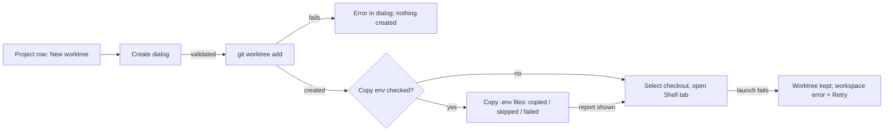

# Git worktree management UX

Phase: S3

## Goal

Manage a registered project's Git worktrees from the sidebar so each checkout gets an
independent terminal workspace while staying under one parent project. The project
root remains the primary checkout; every Git worktree — including ones created
outside Goko — appears as a child checkout with its own name, branch, dirty
summary, path, and session group. This implements the worktree portion of the S3
row of the [roadmap](../../roadmap.md): worktree create/list/remove with
dirty/running guards, a git status summary, and session↔checkout association. The
S3 diff viewer and all other Git features remain out.

## Scope

In:

- A `git`-backed worktree model per registered project: the project root is the
  primary checkout and `git worktree list` supplies every linked worktree,
  including ones created outside Goko. The displayed worktree name is the final
  directory component of its path; the name and the branch are separate values.
- Worktree rows in the project sidebar showing name, branch (or detached HEAD),
  clean/dirty or missing state with a changed-file count when available, path,
  and session count, with
  refresh after mutations and session changes, on project/checkout selection, and
  via a manual refresh action.
- A create dialog supporting a new branch (the default) or an existing local
  branch, a generated-but-editable path of the form
  `../<project-name>-worktrees/<worktree-name>`, a base-ref chooser over local
  and remote-tracking refs without fetching, inline validation of name, path,
  and branch collisions, and a ban on nested worktrees inside an existing
  checkout.
- Optional environment-file copying during creation (checkbox default off):
  top-level regular `.env`/`.env.*` files from the project root or another
  existing checkout, excluding example/sample/template/dist names, with a
  preview and a copied/skipped/failed result.
- Checkout-scoped session launches: `session_create` gains an optional
  `checkout` path that Tauri validates as the project root or a listed Git
  worktree; sessions keep the parent `project_id`, launch with the checkout as
  their initial `cwd`, and group under their checkout using the shell process's
  live `cwd`. Each checkout has its own in-memory terminal workspace keyed by
  its path within the project.
- Accessible create and remove dialogs built with the installed Radix Dialog
  primitive and existing semantic form controls: keyboard operation, visible
  labels and descriptions, focus return to the trigger, and announced errors.
- Guarded removal: a linked, non-root worktree is removed only when it is clean
  and the daemon has no live sessions anywhere; exited sessions attached to the
  target path also block removal. Both checks run again in the backend at remove
  time; the local branch is preserved. Session launches take a shared file lock
  and removal takes it exclusively under `GOKO_HOME`, coordinating multiple app
  processes; the existing in-process read/write lock remains in place.

Out:

- The full diff viewer named in the S3 roadmap row — only the status summary is
  in scope — plus every other Git feature: fetch, pull, commit, branch deletion
  or renaming, worktree lock/unlock UI, pruning stale administrative entries, and
  submodule handling.
- Persisting worktrees, checkout state, or tab layouts: no SQLite worktree table
  or schema change; existing session metadata already carries `project_id` and
  `cwd`.
- Force-removal of dirty worktrees, killing or closing sessions for removal, and
  deleting the project root or any checkout directory when a project
  registration is removed.
- Protocol schema changes: the daemon remains the sole PTY/process authority,
  and live `cwd` uses the existing `SessionInfo` field and event shape.
- Non-Git affordances for projects that are not Git worktree roots (see Edge
  cases: the worktree controls simply do not appear).

Dependency: this change is sequenced after the open
[terminal workspaces plan](../2026-11-02-terminal-workspaces-vietnamese/design.md),
which owns project-level terminal workspaces, tabs, and splits and is still
unmerged in the working tree. Its design keeps `session_create` project-scoped;
this change adds the checkout context while preserving the parent project
association, and it reuses that plan's workspace state rather than replacing it.

## Behavior

**Shared constraints.** Git is invoked as separate argv values through
`std::process::Command`; no shell string is ever built and no new dependency or
Tauri capability is added. The protocol shape stays unchanged; the daemon
refreshes the existing `SessionInfo.cwd` from the PTY child process.
Worktree removal is fail-closed: only a clean, non-root linked worktree with zero
daemon sessions attached to its path — including exited sessions — is removed,
re-checked in the backend at remove time; sessions are never killed or closed for
removal, removal never uses force, the local branch is always preserved, and when
the daemon cannot confirm the session list, the current directory of every
session, or support for live-directory reporting, removal is refused. Removal
also requires every daemon session to be exited or failed, including sessions
in other projects, so an active shell cannot enter the target worktree after
the CWD check. A shared `GOKO_HOME/worktree-operations.lock` serializes session
launches and removals across app processes. The removal
confirmation states that the checkout directory and its local/ignored contents,
including a copied `.env`, will be deleted. Environment copying never follows
symlinks, never overwrites an existing destination file, and never removes the
created worktree when copying fails — the worktree is retained with a retry
path. Removing a project registration never deletes the
project root or any worktree directory. Checkout tab state stays in memory under
the existing terminal-workspaces persistence limit; session association derives
from the recorded `project_id` and live `cwd`, not from new schema. New UI uses the
existing semantic tokens and installed Radix Dialog primitive; checkout rows,
disabled-branch reasons, and dialog fields are keyboard-operable and labeled,
validation errors are announced, and focus returns to the trigger on close.
Blocked remove actions stay keyboard-focusable with `aria-disabled`, and their
reason is available on focus and hover.
TypeScript stays `strict` with no `any` without a comment, terminal bytes never
enter React state, Zustand, or the query cache, and automated tests never launch
a real agent CLI.

**Listing.** Each project whose root is a Git worktree root gains a checkouts
block under its row. The first row is the project root checkout, flagged as the
root; the remaining rows come from `git worktree list` in Git's order, including
worktrees created outside Goko. A row shows the final directory component as its
name, its branch name — or `detached <short oid>` for a detached HEAD — a
clean badge or a dirty badge with the changed-file count (untracked files
count), a truncated path, and the number of daemon sessions whose `cwd` is the
checkout path or inside it. A Git-listed path that is absent from disk stays in
the list with a Missing badge and its session group; it cannot launch new
sessions or be normally removed. The list refetches after any worktree
mutation, when sessions change, when the project or a checkout is selected, and
on demand from a manual refresh action; dirty state is not pushed, so the
summary is only as fresh as the last refresh.

**Create dialog.** A New worktree action on a Git project opens a dialog with:

- **Name** — free text; it feeds the generated path and must be a single path
  component that does not collide with another checkout's name. If the user
  edits the path's final component, the Name field follows it; editing Name
  updates the path while keeping its selected parent directory.
- **Path** — pre-filled as `../<project-name>-worktrees/<name>` relative to the
  project root, editable, with a Choose… button that uses the existing directory
  picker (`dialog:allow-open`; no new capability).
- **Branch mode** — *New branch* (default) with a branch-name field and a base
  ref select, or *Existing branch* with a select of local branches. Branches
  already checked out by another worktree are listed disabled with the reason
  ("checked out at <path>"). The base ref defaults to the currently selected
  checkout's branch — or its current commit when that checkout is detached — and
  can be changed to any available local or remote-tracking ref; Goko never
  fetches.
- **Copy environment files** — checkbox, default off, with a source selector
  (default the project root; any listed checkout is allowed) and a preview list
  of the files that would be copied or excluded, with reasons. Helper text says
  these files may contain secrets and are copied locally, not committed.

The backend re-validates everything at submit: the path must be absent or an
empty directory and must not equal, contain, or sit inside an existing
checkout; a new branch must pass `git check-ref-format` and must not already
exist; an existing branch must be local and not checked out elsewhere. The
dialog stays open on error and shows the message.

**Environment copy.** Only top-level entries of the chosen source checkout whose
file name is `.env` or starts with `.env.` are candidates, and only regular
files — symlinks are skipped and never followed. Names ending in `.example`,
`.sample`, `.template`, or `.dist` (matched case-insensitively) are excluded.
Each eligible file is copied with an exclusive create, so an existing
destination file is never overwritten and is reported as skipped. The copy runs
after `git worktree add` succeeds; a failure reports the copied, skipped, and
failed names, the new worktree is retained, and Retry runs the copy again —
already-copied files then show as skipped, so a retry only attempts the
remainder.

**Activation and sessions.** Selecting a checkout activates its workspace,
keyed by the checkout path within the project; the first activation with no
open tabs creates one Shell tab in that checkout, reusing the terminal
workspaces behavior. Agent, custom-command, new-tab, and split launches from a
checkout workspace send `project_id` plus the checkout path; the backend
verifies the path is the project root or a listed worktree and launches with it
  as the launch `cwd`, so the daemon `SessionInfo.cwd` and the `sessions`
  metadata row keep the parent `project_id` with the checkout `cwd`. Session
  rows group under the checkout whose path matches their live `cwd` (exact or
  descendant match); sessions
matching no listed checkout stay directly under the project, as do all sessions
of a non-Git project. After a worktree is created, Goko selects the new
checkout and opens its first Shell tab; if that launch fails the worktree is
retained, the workspace shows the launch error with Retry, and no phantom tab
or pane appears.

**Live session directory.** The daemon reads the PTY child process's current
working directory while it is running. It refreshes `SessionInfo.cwd` in
`session.list` and `session.get`, and broadcasts a normal `session.updated` event
when the path changes so the sidebar moves the session between checkout groups.
The daemon polls live processes periodically; it does not alter the protocol
shape or persist a second directory value. macOS uses the process vnode path
query and Linux uses `/proc/<pid>/cwd`. If the current directory cannot be read
or represented as UTF-8, the daemon sets `cwd` to an empty string. The UI keeps
that session under the project's other sessions and disables worktree removal;
the backend also refuses every worktree removal while any session has an
unknown or unresolvable `cwd`. Exited sessions retain their last known `cwd` and
continue to block removal when it is inside the checkout.

The client checks the existing handshake's `daemon_version` before removing a
worktree. Live-CWD tracking requires daemon version `0.1.1` or later; an older
persistent daemon is refused with an update/restart message. Goko does not
restart it automatically, because it may own other sessions. `daemon_status`
exposes whether the connected daemon supports live CWD, so the sidebar disables
removal with that reason before opening the confirmation dialog. The handshake
shape and protocol version remain unchanged.

**Removal.** A non-root checkout row offers Remove. A two-step confirmation
states the exact path, that the branch is preserved, and that removing the
checkout deletes its directory contents, including ignored local files such as
a copied `.env`; a dirty worktree or attached sessions refuse removal. At remove
time the backend re-lists worktrees (the target must be a linked worktree of
this project, never the root), re-runs the dirty check, and re-fetches
`session.list`: any session whose live `cwd` is the checkout path or inside it —
running or exited — refuses removal with the count. If any session has an
unknown or unresolvable directory, or the daemon cannot answer, removal is
refused because Goko cannot prove the checkout is unused. Before checking
attached CWDs, removal refuses if any daemon session is live, even when that
session belongs to another project or checkout. Only then does
`git worktree remove` run, without `--force`; a Git-level refusal (for example
a locked worktree) surfaces its message. On success the checkout's in-memory
workspace — necessarily empty of sessions — is dropped and the list refreshes.
If the removed checkout was active, the project-root checkout becomes active
and restores its workspace, creating a Shell tab only if that workspace has no
open tabs.

**Missing worktrees.** If a worktree directory disappears outside Goko, Git
continues to list its stale administrative entry until it is pruned. Goko keeps
the row with a Missing badge and its session group, disables new launches and
normal removal, and tells the user to restore the directory or prune the stale
entry with Git. If the entry is later pruned, sessions whose `cwd` no longer
matches a listed checkout remain visible directly under the project. Goko does
not run repository-wide pruning automatically.

## Edge cases

- A project root that is not a Git worktree root — not a repository, a bare
  repository, or a subdirectory inside one — reports `repo: false`: no worktree
  controls appear and sessions stay grouped flat under the project.
- `git` missing on `PATH` rejects worktree commands `invalid_argument` with an
  install hint; session launches are unaffected.
- A worktree created outside Goko appears on the next list refresh; a worktree
  directory removed outside Goko stays listed as Missing until its stale Git
  administrative entry is pruned. Its existing terminal sessions remain
  reachable under that row; new launches and normal removal are disabled. After
  the user restores the directory or prunes the entry externally, the list is
  refreshed and any unmatched sessions group directly under the project.
- A project root moved or deleted keeps its `missing` behavior: worktree
  commands fail `invalid_argument` and no create/remove control is enabled.
- Name or path collisions — an empty name, a name with a path separator or
  `.`/`..`, an existing non-empty directory, a path equal to or nested inside an
  existing checkout — are rejected `invalid_argument` before Git runs.
- A new branch name that fails `git check-ref-format` or already exists is
  rejected; an existing branch checked out by another worktree — including one
  checked out between dialog open and submit — is rejected at create time.
- A detached selected checkout defaults the base ref to its current commit;
  rows show `detached <short oid>` in place of a branch.
- A source checkout with no eligible `.env` files shows an empty preview; a
  symlinked `.env` is skipped; an existing destination file is skipped; a
  partial copy failure keeps the worktree and reports each failed name for
  retry.
- A shell that changes directory moves its session row and checkout count after
  the next daemon refresh. If the daemon cannot read a live process directory,
  its empty `cwd` leaves the session under the project's other sessions and
  blocks removal of every linked worktree until that session is deleted.
- Session launch and removal locks also coordinate separate Goko processes
  sharing the same `GOKO_HOME`; an in-flight launch finishes before removal
  checks the session list.
- Worktree removal is disabled while any daemon session is live, including a
  session in another project. If the connected daemon predates live-CWD tracking
  (before version `0.1.1`), removal fails with an update/restart message and
  does not restart the daemon or touch the worktree.
- Removal refuses with the reason shown: N changed files when dirty, M attached
  sessions when any daemon session's live `cwd` is inside the path (including
  exited sessions), an active-session error when any daemon session is running,
  an old-daemon error when live-CWD support is missing, an unknown-directory
  error when any session `cwd` is empty or unresolvable, the daemon error when
  `session.list` cannot confirm, `not_found` when the path is no longer a linked
  worktree, and Git's own message when `git worktree remove` refuses. The
  confirmation always warns that removing the directory also deletes ignored
  local files, including a copied `.env`; after removing the active checkout,
  Goko falls back to the project root.
- `session_create` with `checkout` but no `project_id`, or with a `checkout`
  that is neither the project root nor a listed worktree, is rejected
  `invalid_argument` before the daemon is reached.
- Removing the project registration rehomes every checkout workspace's tabs
  under **Unassigned** and deletes no directory.
- A storage failure rejects worktree commands with `storage` (the project id
  cannot be resolved to its root) while daemon-backed session commands keep
  working.

## Interfaces

Backend, all new in `apps/desktop/src-tauri/src/worktrees.rs` and exposed as
Tauri commands registered in `lib.rs::handler()`; errors reuse the existing
`invalid_argument`, `not_found`, `internal`, `storage`, and daemon passthrough
codes — no new error code and no `errors.ts` change.

- `worktree_list { project_id } -> { repo: boolean, worktrees: WorktreeInfo[] }`
  — `repo: false` when the registered root is not a Git worktree root.
  `WorktreeInfo { name, path, branch: string | null, head, is_root, missing,
  dirty: boolean | null, changed: number | null }` where `name` is the final
  path component, `head` the short commit oid, `is_root` the canonical-path
  match with the project root, and `missing` means Git lists the worktree but
  its directory is absent. `dirty` and `changed` are null for a missing path;
  otherwise `changed` is the parsed file count from NUL-delimited Git status
  output, including untracked files.
- `worktree_branches { project_id } -> { branches: BranchInfo[], bases: BaseRef[] }`
  — `BranchInfo { name, checked_out_at: string | null }` lists local branches
  with the path of the worktree holding each; `BaseRef { name, kind: "local" |
  "remote" }` lists `refs/heads` and `refs/remotes` names for the base select.
- `worktree_create { project_id, path, mode: "new" | "existing", branch,
  base: string | null } -> WorktreeInfo` — validates the name derived from the
  final path component, the path itself, and the branch rules, creates missing
  parent directories, then runs `git worktree add` (`-b <branch> <base>` for
  `new`).
- `worktree_remove { project_id, path } -> ()` — re-checks linked-worktree
  membership and cleanliness; requires a daemon version with live-CWD support,
  zero live daemon sessions globally, and zero attached sessions with known
  current directories; serializes session launches across processes using the
  shared `GOKO_HOME` lock file, then runs `git worktree remove` without `--force`.
- `daemon_status` adds `live_cwd_supported: boolean | null` so the worktree UI
  can explain when an older persistent daemon must be restarted manually.
- `env_file_candidates { project_id, source_path } -> EnvFileCandidate[]` —
  `{ name, eligible, reason }` for the dialog preview.
- `env_copy { project_id, source_path, target_path } -> EnvCopyReport` —
  `{ copied: string[], skipped: string[], failed: { name, error }[] }`; both
  paths must be listed checkouts of the project.
- `session_create` gains optional `checkout: string`, accepted only together
  with `project_id`; when present it must canonicalize to the project root or a
  listed worktree and becomes the launch `cwd` while `project_id` still records
  the parent project. The daemon updates the existing `SessionInfo.cwd` to the
  process's live directory without changing its JSON shape. Every existing
  caller keeps working.

Inside `worktrees.rs`: `git(root, args: &[&str]) -> Result<Vec<u8>, BridgeError>`
runs `git -C <root> <args>` capturing stdout and maps a missing binary to
`invalid_argument` with an install hint and a non-zero exit to an error
carrying Git's stderr; `list_worktrees`, `status_counts`, `branches`,
`base_refs`, `add`, `remove`, `env_candidates`, and `env_copy` are the pure
steps the commands compose. Parse `git worktree list --porcelain -z` and
`git status --porcelain=v1 -z --untracked-files=all` as NUL-delimited output so
paths containing spaces or newlines remain unambiguous. Canonicalize existing
paths; for a new target, resolve and validate its nearest existing ancestor
before creating parent directories, then canonicalize the created parent before
running Git.

Frontend:

- `services/types.ts` gains `WorktreeInfo`, `WorktreeList`, `BranchInfo`,
  `BaseRef`, `EnvFileCandidate`, `EnvCopyReport` mirrored from the backend;
  `CreateSessionInput` in `services/session.ts` gains `checkout?: string`.
- `services/worktrees.ts` (new) exposes `worktreeService` with `list`,
  `branches`, `create`, `remove`, `envCandidates`, and `envCopy`.
- `queryClient.ts` gains `worktrees(projectId)` and
  `worktreeBranches(projectId)` keys.
- `features/worktrees/` (new): `queries.ts` with the worktree query/mutation
  hooks (invalidating `worktrees(projectId)` on activation and after every
  mutation), `WorktreeRows.tsx` for the per-project checkout block and its
  nested session rows, and `WorktreeCreateDialog.tsx` for the accessible Radix
  dialog including the env preview and result report; the remove confirmation
  uses the same installed Radix Dialog primitive. No dialog dependency is added.
- `stores/ui.ts` gains `checkoutKey(projectId, checkoutPath)`; `workspaces` and
  the active workspace are keyed by it (the root checkout uses the project
  root path; **Unassigned** is unchanged), and `removeProject` rehomes every
  workspace keyed under the removed project.
- `features/projects/ProjectTree.tsx` renders `WorktreeRows` inside each Git
  project and groups session rows under their checkout by `cwd`;
  `features/terminal/TerminalWorkspace.tsx` takes the checkout path and sends
  it as `checkout` on session creates; `App.tsx` resolves the active
  workspace's project and checkout.

Security and data-safety boundaries: every Git invocation is
`Command::new("git")` with separate args — branch, base, and path values are
never interpolated into a shell string; the path and branch rules above are
validated before any mutation; env sources and targets are restricted to
listed checkouts of the project; copies use `symlink_metadata` (no symlink
following) and exclusive-create writes (no overwrite); removal is fail-closed
against the dirty check, daemon version, live sessions, and current directories;
and no project, worktree, or session deletion removes an unrelated directory or
kills a process.

## Verification

- `cargo test -p desktop` — `worktrees.rs` unit and command tests against real
  Git repositories created in temp dirs (`git init`, `git worktree add`): list
  shows root plus external worktrees with names, branches, detached oids, and
  dirty counts; non-Git roots return `repo: false`; the validation matrix
  (name/path/branch collisions, nested paths, checked-out branches, detached
  bases) rejects before mutating; env preview and copy apply the include,
  exclude, no-symlink, and no-overwrite rules and report partial failures;
  removal refuses dirty worktrees, attached live and exited sessions, daemon
  outages (fail closed), and non-linked or root paths, while a clean removal
  preserves the local branch; `session_create` checkout cases reject bad input
  before the daemon and record `cwd` on success.
- `pnpm -C apps/desktop test` — checkout rows render name/branch/dirty/path/
  session counts; refresh on selection and manual refresh; the dialog's
  defaults, generated path, disabled branches, base-ref default, env preview,
  and copied/skipped/failed report with retry; post-create checkout activation
  and first Shell tab; shell-launch failure retention without a phantom tab;
  removal confirmation, refusal reasons, and success cleanup; checkout-keyed
  workspace isolation and session grouping by `cwd`; project removal rehoming.
- `cargo test --workspace` — daemon session tests prove that a shell changing
  directory updates `session.list`, `session.get`, and `session.updated`; Tauri
  removal tests prove a session launched in the project root then moved into a
  linked worktree blocks removal, a live session elsewhere and an old daemon
  block removal, and an unknown `cwd` fails closed.
- `cargo fmt --check`,
  `cargo clippy --workspace -- -D warnings`, `cargo build --workspace`,
  `pnpm -C apps/desktop typecheck`, `pnpm -C apps/desktop test`, and
  `pnpm -C apps/desktop build` — desktop tests cover unknown-CWD and global-live-
  session removal-disabled states.
- Manual macOS checklist (recorded per item like s1-13): register a Git
  project; create a worktree on a new branch and on an existing free branch;
  see an externally created worktree appear; confirm checked-out branches are
  disabled with reasons; create with env copy on and verify the
  copied/skipped/failed report and file contents; open agents in two
  checkouts side by side and confirm separate workspaces; dirty a worktree and
  confirm removal refusal with the count, then clean and remove while its
  branch survives; confirm removal refusal with an attached exited session;
  confirm removal is blocked while a session in another project is live;
  remove the project and confirm no directory is deleted.

## Related context

None. `docs/llm/` is absent; there is no verified wiki coverage.

## Previous work

- [roadmap](../../roadmap.md) — the S3 row this partially implements; the diff
  viewer and remaining Git work stay for a later S3 change.
- [S2 Projects, agents, and sessions design](../archive/2026-10-30-s2-projects-agents-sessions/design.md)
  and [tasks](../archive/2026-10-30-s2-projects-agents-sessions/tasks.md) —
  registered projects, daemon-owned sessions, project/session metadata, and the
  project tree this extends.
- [Terminal workspaces design](../2026-11-02-terminal-workspaces-vietnamese/design.md)
  and [tasks](../2026-11-02-terminal-workspaces-vietnamese/tasks.md) — the open
  dependency owning project-level workspaces, tabs, splits, and close
  lifecycle that this change sequences after.
